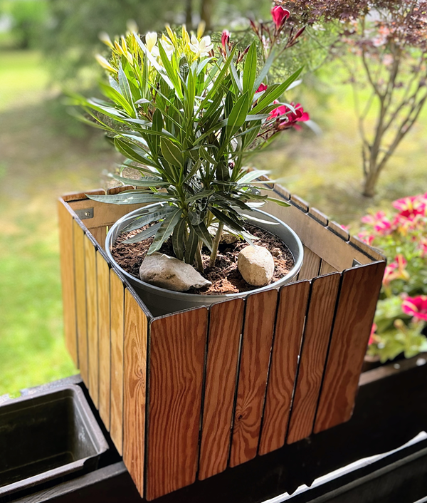
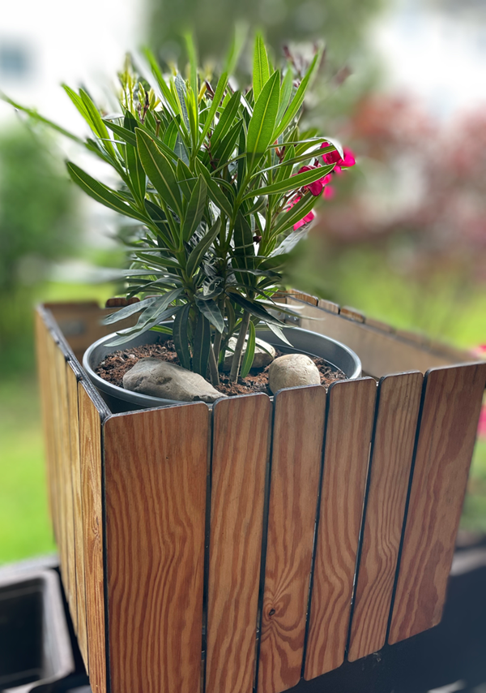
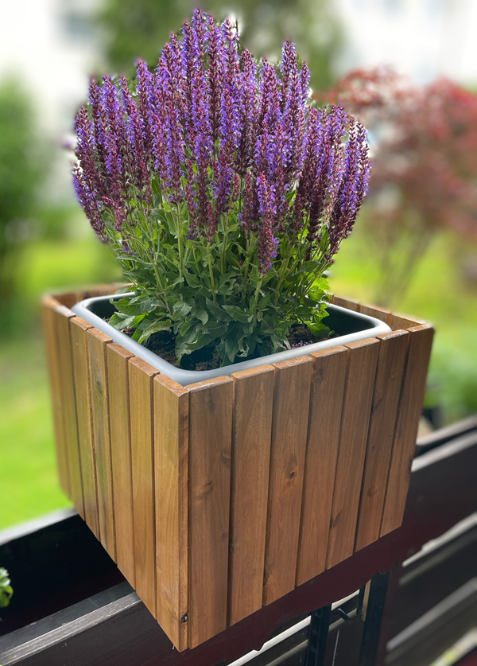

# Blumenkasten aus Holz

  
|[:skull:ISSUE](https://github.com/frankyhub/Blumenkasten/issues)|[:speech_balloon: Forum /Discussion](https://github.com/frankyhub/Blumenkasten/discussions)|[:grey_question:WiKi](https://github.com/frankyhub/Blumenkasten/blob/main/wiki.md)| ||
|--|--|--|--|--|
| | | | | |
||<a href="https://github.com/frankyhub/Blumenkasten/issues">|<a href="https://github.com/frankyhub/Blumenkasten/discussions">|<a href="https://github.com/frankyhub/Blumenkasten/releases">| |
|![GitHub Created At] 09.06.2026| <a href="https://github.com/frankyhubBlumenkasten/pulse" alt="Activity">| <a href="https://github.com/frankyhub/Blumenkasten/graphs/traffic">  |<a href="https://github.com/frankyhub?tab=stars"> | ||

---

   
<ol class="breadcrumb" style="border-top: 2px solid black;border-bottom:2px solid black; height: 45px; width: 900px;"> 
<a href="#oben">nach oben</a>
</ol>

 

-------------------------------------------

